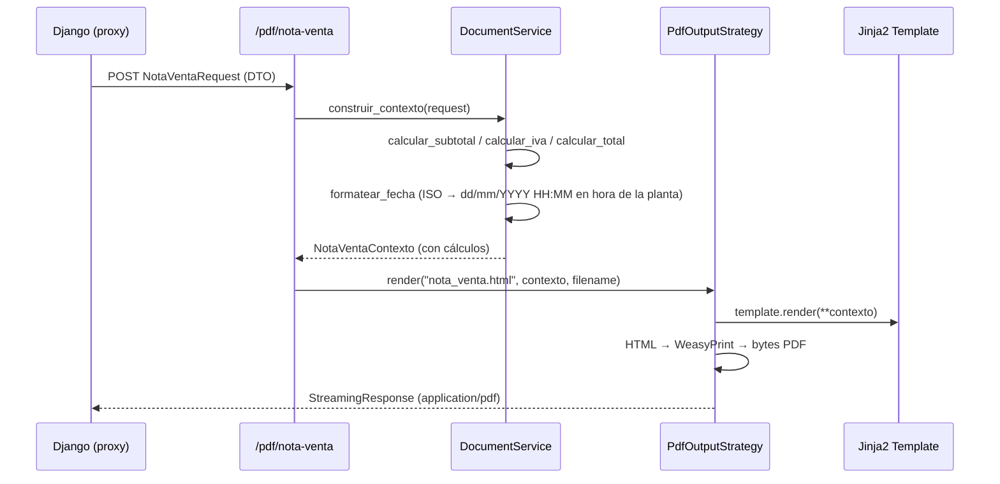

# Servicio Satélite de Impresión (`printing_service`)

Servicio satélite FastAPI dedicado a la generación de documentos PDF (notas de venta, guías de remisión, reportes de producción y despachos, hojas de dosificación, etiquetas universales) y etiquetas ZPL para impresoras Zebra. Desacopla las dependencias pesadas de WeasyPrint del núcleo Django.

> **Refactorizado:** 2026-04-23 — Se aplicó arquitectura de capas SOLID con Strategy Pattern y separación DTO/Servicio.
> **Estado al 14-oct-2026:** 11 endpoints (9 PDF, 1 ZPL y `/health`), 107 pruebas con cobertura mínima del 95 %, JWT RS256 obligatorio en todo salvo `/health`.
> **Extendido:** 2026-07-20 — F5 del módulo de Gestión de Etiquetas (ver [GESTION_ETIQUETAS.md](../modulos/GESTION_ETIQUETAS.md)): endpoint `/pdf/etiqueta` (fallback universal para impresoras no-Zebra) + campos de gobernanza (`motivo`, `tipo_evento`, `version`, `usuario`) en `EtiquetaRequest` y `PrintAuditLog`.

---

## Arquitectura de Capas

```
printing_service/src/
  config.py                  ← Rutas de templates ancladas al paquete (no al cwd)
  schemas/
    printing.py              ← DTOs de entrada (NotaVentaRequest, EtiquetaRequest)
                               + NotaVentaContexto (schema para el template)
  services/
    document_service.py      ← Lógica de negocio: cálculo IVA, subtotal, formateo de fecha
    label_service.py         ← Contexto de la etiqueta (sellos de reimpresión/reetiquetado)
    zpl_sanitizer.py         ← Escapa los datos antes de interpolarlos en ZPL
    output_strategy.py       ← Strategy Pattern: PdfOutputStrategy / ZplOutputStrategy
  routers/
    pdf.py                   ← POST /pdf/{nota-venta, etiqueta, reporte-avance, reporte-balance,
                               historial-despachos, produccion-por-producto, guia-remision,
                               formula-dosificacion, historial-mantenimiento}
    zpl.py                   ← POST /zpl/etiqueta
    health.py                ← GET /health
  templates/
    nota_venta.html
    guia_remision.html
    historial_despachos.html
    produccion_por_producto.html
    reporte_avance.html       ← A4 horizontal
    reporte_balance.html      ← A4 vertical
    formula_dosificacion.html ← Hoja de dosificación (marca «BORRADOR» si no es la versión oficial)
    etiqueta.zpl             ← Zebra (con sello REIMPRESION/REETIQUETADO vN)
    etiqueta_label.html       ← PDF universal 100×150mm (fallback no-Zebra)
  main.py                    ← App factory + middleware JWT RS256
```

### Diagrama de flujo de una solicitud PDF



---

## Patrones de Diseño Aplicados y su Justificación

### SRP — Separación de responsabilidades

**Problema anterior:** `NotaVentaRequest` era al mismo tiempo el schema de entrada HTTP **y** el portador de lógica de negocio (`@property subtotal`, `@property iva`, `@property total`). Además, el endpoint calculaba y formateaba fechas en línea.

**Solución:**

| Clase | Responsabilidad única |
|---|---|
| `NotaVentaRequest` | DTO de entrada: transporta datos del HTTP al servicio. Sin lógica. |
| `NotaVentaContexto` | Schema de salida para el template: lleva los cálculos ya hechos. |
| `DocumentService` | Toda la lógica de negocio: IVA, subtotal, total, formateo de fechas. |
| `PdfOutputStrategy` | Renderizar HTML → PDF con WeasyPrint. |
| `ZplOutputStrategy` | Renderizar template Jinja2 → texto ZPL. |
| `routers/pdf.py` | Solo traducir HTTP → DocumentService → Strategy → Response. |

### Strategy Pattern (OCP) — Formato de salida extensible

**Problema anterior:** El formato de salida estaba hardcodeado en el endpoint. Agregar soporte a PNG o HTML crudo requería modificar el endpoint existente.

**Solución:** `OutputStrategy` es un `Protocol` (interfaz) que define `render(template_name, context, filename) → Response`. Agregar un nuevo formato solo requiere una nueva clase:

```python
# Protocol definido en services/output_strategy.py
@runtime_checkable
class OutputStrategy(Protocol):
    def render(self, template_name: str, context: dict, filename: str) -> Response: ...

# Implementaciones concretas — agregar HtmlOutputStrategy no toca el router
class PdfOutputStrategy:   ...  # WeasyPrint
class ZplOutputStrategy:   ...  # Jinja2 texto plano
```

### Fechas en hora de la planta

Django envía las fechas en UTC. `DocumentService.formatear_fecha` las muestra como `dd/mm/aaaa HH:MM` en la zona de `ZONA_HORARIA_PLANTA` (`config.py`, por defecto `America/Guayaquil`):

| Entrada | Salida |
|---|---|
| ISO con zona, por ejemplo `2026-10-27T18:23:00Z` | `27/10/2026 13:23`. Pasada la medianoche UTC, se respeta el día de la planta |
| ISO sin zona, por ejemplo `2026-10-27T13:23:00` | `27/10/2026 13:23`; se asume que ya es hora local |
| Texto ya formateado, por ejemplo `27/10/2026 13:23` | igual |

`get_pdf_strategy()` la registra como el filtro `fecha_hora` de Jinja. Las plantillas lo usan para `generado_en` (`{{ generado_en | fecha_hora }}`) y la nota de venta, para `fecha_pedido`. Las pruebas que renderizan plantillas reales usan ese mismo entorno.

### Fragilidad operacional eliminada (config.py)

**Problema anterior:** `FileSystemLoader("templates")` dependía del directorio de trabajo al arrancar el proceso (`cwd`). En Docker, el proceso puede arrancar desde `/app` o `/app/src` según el `CMD`, rompiendo el servidor silenciosamente.

**Solución:**

```python
# config.py — ruta absoluta anclada al paquete
_SRC_DIR = Path(__file__).parent
TEMPLATES_DIR = str(_SRC_DIR / "templates")  # Siempre correcto sin importar cwd
```

### DIP — Inyección de dependencias vía FastAPI `Depends`

Cada router recibe su strategy vía `Depends`:

```python
def get_pdf_strategy() -> PdfOutputStrategy:
    env = Environment(loader=FileSystemLoader(TEMPLATES_DIR))
    return PdfOutputStrategy(env)

@router.post("/nota-venta")
async def generate_nota_venta_pdf(
    data: NotaVentaRequest,
    strategy: PdfOutputStrategy = Depends(get_pdf_strategy),  # ← DIP
):
    ...
```

Esto permite sobrescribir la strategy en tests (`app.dependency_overrides`) sin necesidad de mockear imports a nivel de módulo.

---

## Endpoints

### `GET /health`

Verifica que los templates requeridos existan en el sistema de archivos.

```json
200: { "status": "ok", "templates": "ok" }
503: { "detail": "Templates ausentes: ['nota_venta.html']" }
```

### `POST /pdf/nota-venta`

Genera la nota de venta en PDF.

**Body (`NotaVentaRequest`):**

```json
{
  "id": 42,
  "guia_remision": "GR-001",
  "fecha_pedido": "2026-04-23T10:00:00",
  "cliente_nombre": "Empresa XYZ",
  "cliente_ruc": "0990123456001",
  "esta_pagado": false,
  "valor_retencion": 5.0,
  "detalles": [
    {
      "producto_descripcion": "Hilo Nylon",
      "cantidad": 1.0,
      "piezas": 10,
      "peso": 25.0,
      "precio_unitario": 4.50,
      "incluye_iva": true
    }
  ]
}
```

**Response:** `StreamingResponse (application/pdf)` — archivo descargable.

> El `DocumentService` calcula internamente: subtotal, IVA (15% Ecuador sobre ítems con `incluye_iva=true`), total y formatea `fecha_pedido` a `dd/mm/YYYY HH:MM`.

### `POST /zpl/etiqueta`

Genera la etiqueta de producto en formato ZPL para impresoras Zebra.

**Body (`EtiquetaRequest`):**

```json
{
  "empresa": "TexCore Industrial",
  "producto_desc": "Hilo Nylon 100%",
  "lote_codigo": "LOTE-00123",
  "peso_neto": 25.5,
  "unidad": "kg",
  "qr_data": "https://texcore.local/lotes/LOTE-00123",
  "tipo_evento": "ORIGINAL",
  "version": 1,
  "motivo": null,
  "usuario": null,
  "reimpreso": false
}
```

> Los últimos cinco campos son de **F5 — gobernanza de reimpresión/reetiquetado** (ver
> [GESTION_ETIQUETAS.md](../modulos/GESTION_ETIQUETAS.md)). Son opcionales — si se omiten,
> `tipo_evento` por defecto es `"ORIGINAL"` y `version` es `1`. Cuando `tipo_evento` es
> `REIMPRESION` o `REETIQUETADO`, la plantilla `etiqueta.zpl` imprime un sello visual
> (`REIMPRESION vN` / `REETIQUETADO vN`) para distinguir físicamente la copia del original.

**Response:** `PlainTextResponse (text/plain)` — instrucciones ZPL listas para enviar a la impresora.

### `POST /pdf/etiqueta`

**F5 — fallback universal para impresoras de etiquetas sin soporte ZPL nativo (no Zebra).**
Mismo DTO de entrada (`EtiquetaRequest`) que `/zpl/etiqueta`, pero renderiza `etiqueta_label.html`
(tamaño 100×150mm) vía `PdfOutputStrategy` (WeasyPrint) en lugar de texto ZPL. Reutiliza la
`PdfOutputStrategy` existente sin crear una clase nueva — el tamaño de página se controla con
CSS (`@page { size: 100mm 150mm; }`), no por lógica de la estrategia (OCP: cero cambios en
`output_strategy.py`).

**Response:** `StreamingResponse (application/pdf)`.

> Django expone este endpoint indirectamente vía `GET /lotes-produccion/{id}/generate-pdf-label/`
> (`PrintingService.generate_label_pdf` en `gestion/utils.py`), que el frontend usa como fallback
> cuando no hay impresora Zebra disponible (`frontend/src/lib/printing.ts` → `printLabel()`).

### `POST /pdf/reporte-avance`

Genera el reporte de Avance Operativo (orientación horizontal A4).

**Body (`ReporteAvanceRequest`):**

```json
{
  "empresa_nombre": "TexCore Industrial",
  "sede_nombre": "Planta Norte",
  "fecha_desde": "2026-07-01",
  "fecha_hasta": "2026-07-31",
  "maquina_filtro": null,
  "operario_filtro": null,
  "generado_en": "2026-07-30T10:00:00Z",
  "detalles": [
    {
      "orden": "OP-001",
      "producto": "Hilo Nylon",
      "lote": "LOTE-123",
      "maquina": "Tejedora 1",
      "operario": "jdoe",
      "kilos": 150.5,
      "porcentaje_avance": 75.25,
      "estado": "en_proceso"
    }
  ]
}
```

**Response:** `StreamingResponse (application/pdf)`.

### `POST /pdf/reporte-balance`

Genera el reporte de Balance de Masas Mensual (orientación vertical A4).

**Body (`BalanceMasasRequest`):**

```json
{
  "empresa_nombre": "TexCore Industrial",
  "sede_nombre": "Planta Sur",
  "mes": "Julio 2026",
  "generado_en": "2026-07-30T10:00:00Z",
  "detalles": [
    {
      "codigo": "MAT-001",
      "descripcion": "Químico A",
      "inventario_inicial": 100.0,
      "produccion": 50.0,
      "egresos": 160.0,
      "stock_actual": -10.0,
      "is_negativo": true
    }
  ]
}
```

**Response:** `StreamingResponse (application/pdf)`.

---

### `POST /pdf/historial-despachos`, `/pdf/produccion-por-producto`, `/pdf/guia-remision`, `/pdf/formula-dosificacion` y `/pdf/historial-mantenimiento`

Siguen el mismo patrón: un DTO Pydantic de entrada (`HistorialDespachosRequest`, `ProduccionPorProductoRequest`, `GuiaRemisionRequest`, `FormulaDosificacionRequest`, `HistorialMantenimientoRequest` en `schemas/printing.py`), una plantilla HTML y `StreamingResponse (application/pdf)`.

| Endpoint | Lo pide Django desde | Documento |
|---|---|---|
| `/pdf/historial-despachos` | `inventory/views/despacho_views.py` | Historial de despachos filtrado |
| `/pdf/guia-remision` | `inventory/views/despacho_views.py` | Guía de remisión de un despacho |
| `/pdf/produccion-por-producto` | `gestion/views/kpi_views.py` | Producción por producto del panel ejecutivo |
| `/pdf/formula-dosificacion` | `gestion/views/formula_views.py` (`POST /api/formula-colors/{id}/imprimir-dosificacion/`) | Hoja de dosificación para un peso y litros de baño: versión oficial o, sin ella, receta viva marcada «BORRADOR» |
| `/pdf/historial-mantenimiento` | `gestion/views/production_maquina_views.py` (`POST /api/paros-maquina/imprimir-historial/`) | Historial de mantenimiento y paros del área (A4 horizontal): totales del rango, resumen por máquina y detalle paro por paro |

---

## Tests

```
tests/
  test_auth_middleware.py        ← JWT obligatorio: sin header, sin Bearer, expirado, tipo o emisor incorrecto; /health exento
  test_nota_venta_calculos.py    ← cálculos de la nota de venta vía DocumentService
  unit/
    test_document_service.py     ← DocumentService (sin HTTP, sin WeasyPrint)
    test_label_service.py        ← contexto y sellos de la etiqueta
    test_zpl_sanitizer.py        ← escape de datos en ZPL
    test_audit_repository.py     ← AuditRepository / build_print_record (incl. campos F5)
    test_printing_endpoints.py   ← los 10 endpoints de documentos (mocks de strategy/audit)
    test_database_engine.py
    test_concurrency.py
```

107 pruebas. Las de `DocumentService` no requieren WeasyPrint (la importación es lazy, dentro de `render`). `pytest.ini` exige `--cov-fail-under=95` y el CI lo aplica.

---

## Integración con Django

Django envía los datos vía HTTP POST desde `gestion/utils.py` (clase `PrintingService`):

```python
pdf_content = PrintingService.generate_nota_venta_pdf(data_dict)   # /pdf/nota-venta
zpl = PrintingService.generate_zpl_label(data_dict)                # /zpl/etiqueta
pdf_bytes = PrintingService.generate_label_pdf(data_dict)           # /pdf/etiqueta (F5)
PrintingService.generate_historial_despachos_pdf(data_dict)          # /pdf/historial-despachos
PrintingService.generate_produccion_por_producto_pdf(data_dict)      # /pdf/produccion-por-producto
PrintingService.generate_guia_remision_pdf(data_dict)                # /pdf/guia-remision
PrintingService.generate_formula_dosificacion_pdf(data_dict)         # /pdf/formula-dosificacion
PrintingService.generate_historial_mantenimiento_pdf(data_dict)      # /pdf/historial-mantenimiento
```

Los reportes de avance y balance los pide `internal_api/views/pdf_produccion_views.py`. Todas las llamadas llevan el encabezado de `_printing_auth_headers()`; el 13-oct-2026 se corrigieron los cuatro métodos que se habían agregado sin él y recibían 401.

El servicio no accede a la base de datos; recibe todos los datos en el body. Si no responde
(timeout o caído), `generate_zpl` en `gestion/views/production_lote_views.py` degrada a un ZPL de fallback generado
localmente en Django (`LoteProduccionViewSet._build_zpl_fallback`), y `generate-pdf-label/`
responde `503` para que el frontend recurra al último fallback (portapapeles).

---

## Seguridad — Autenticación JWT (2026-09-22)

> **Hallazgo corregido:** hasta esta fecha, `printing_service` era el único de los
> tres microservicios satélite sin ninguna autenticación — `scanning_service` y
> `reporting_excel` ya exigían JWT RS256 desde la evolución descrita en
> `docs/arquitectura/MICROSERVICIOS.md` §5, pero `printing_service` aceptaba
> peticiones de cualquier actor con acceso a la red interna de Docker. Esto
> permitía generar PDFs de notas de venta (datos de clientes, montos) y
> etiquetas ZPL arbitrarias sin credenciales. Ver `docs/requerimientos/REGISTRO_RIESGOS.md` (RS-09).

Todos los endpoints excepto `GET /health` ahora exigen `Authorization: Bearer <JWT RS256>`, verificado por el middleware `verify_jwt_service_token` en `src/main.py` (mismo esquema que `reporting_excel`: valida firma con `INTERNAL_JWT_PUBLIC_KEY`, `iss=texcore`, `type=service_access`).

```
Antes:
  Django (o cualquiera en la red Docker) ──HTTP sin auth──► printing_service

Después:
  Django ──JWT RS256 (generate_token, TTL 60s)──► printing_service (verifica firma con clave pública)
```

- **Django firma el token** en `gestion/utils.py::_printing_auth_headers()`, reutilizando `JWTServiceAuthentication.generate_token()` (ya existente en `internal_api/authentication.py`, sin duplicar lógica).
- **`printing_service` requiere `INTERNAL_JWT_PUBLIC_KEY`** como variable de entorno obligatoria (fail-fast si falta), igual que sus pares.
- **Dependencias**: `PyJWT==2.15.0` y `cryptography==50.0.1` (esta última necesaria para que PyJWT soporte RS256 — sin ella la verificación falla con `Algorithm not supported`).
- **Tests**: `printing_service/tests/test_auth_middleware.py` — 9 casos cubriendo ausencia de header, header sin `Bearer`, token expirado, tipo de token incorrecto, emisor no reconocido, y que `/health` sigue exento.
